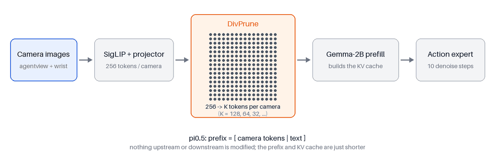
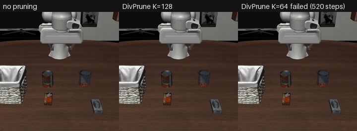
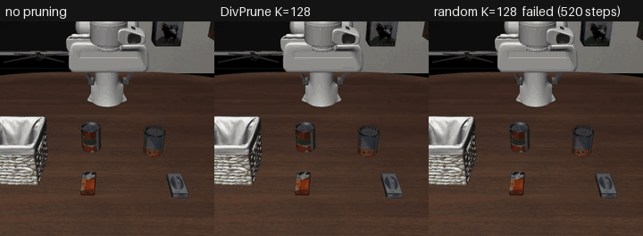
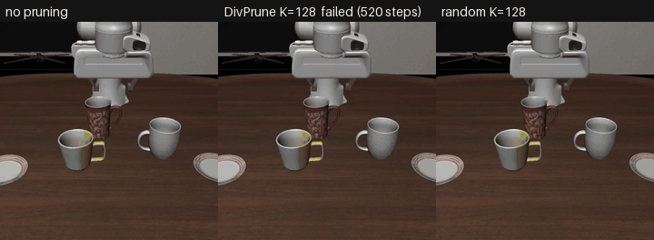
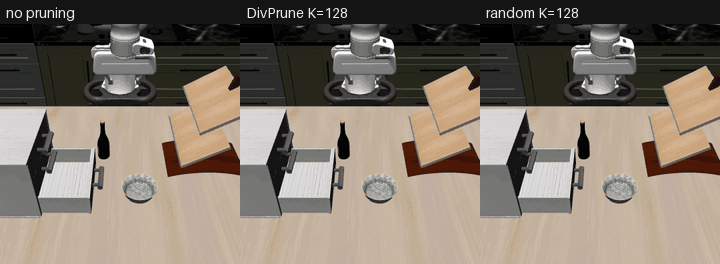

# prune-vla

Visual-token pruning for the **pi0.5** vision-language-action policy, evaluated on **LIBERO-10**.

The pruning rule is [DivPrune](https://arxiv.org/abs/2503.02175) (Alvar et al., CVPR 2025): keep the K visual tokens
that are most different from each other (a max-min diversity problem on cosine distance) and drop the rest. It needs
no training and no attention scores. Here it is applied to pi0.5's image tokens, so the Gemma backbone and the action
expert's KV cache see a shorter visual prompt.

<p align="center">
  
</p>

Nothing in the model is modified. `prune_vla.apply_pruning(policy, PruneConfig(...))` wraps two methods of a LeRobot
`PI05Policy` on the instance and can be undone with `handle.restore()`.

## Methods

| `--method` | what it keeps |
|---|---|
| `none` | all 256 tokens per camera |
| `divprune` | K max-min-diverse tokens (greedy, cosine distance) |
| `random` | K uniformly random tokens (same seed for every call) |
| `pool` | K tokens from average-pooling the 16x16 token grid (K = 64, 16, ...) |

`--compact` additionally drops prefix slots that are padding for the whole batch (pi0.5's unused third camera slot and
the unused language slots). This does not change the model's output and gives the fair "no pruning" baseline for latency.

## Setup

```bash
git clone --recurse-submodules https://github.com/mpodolinsky/prune-vla && cd prune-vla
uv sync --group dev
```

Python 3.12, one CUDA GPU (about 16 GB for the fp32 checkpoint). The LIBERO code is the
[`huggingface/LIBERO`](https://github.com/huggingface/LIBERO) fork in `submodules/LIBERO`; its simulation assets are
downloaded from the Hub (`lerobot/libero-assets`) on first use, and the policy is `lerobot/pi05_libero`.

## Run

```bash
# one condition: 10 LIBERO-10 tasks x 5 episodes, with per-call timings
uv run python -m prune_vla.eval_libero --method divprune --tokens-per-camera 64 --compact --n-episodes 5 --profile

# the full sweep, then a table
N_EPISODES=5 scripts/run_sweep.sh
uv run python scripts/summarize.py
```

Evaluation goes through LeRobot's own `lerobot-eval` loop (image flips, state layout, 520-step limit), so the
`none` row is the stock policy. Extra `lerobot-eval` flags can be appended after `--`. Each run writes
`eval_info.json`, `prune_stats.json` (prefix length, prefill / denoise / total ms per policy call) and rollout videos
to `outputs/<method>_k<K>[_compact]/`.

## Tests

```bash
uv run pytest                 # selection logic (CPU)
uv run pytest -m gpu          # on the real checkpoint: K=256 is bit-identical to the unpatched policy,
                              # compaction leaves actions unchanged, pruned prefix has the expected length
```

## Results

LIBERO-10, `lerobot/pi05_libero`, 10 tasks x 5 episodes per row (same initial states and seed in every row), RTX 4090,
no finetuning. K is the number of tokens kept per camera. "Total" is one policy call (SigLIP + prefill + 10 denoise
steps), timed with CUDA syncs. Regenerate with `scripts/run_sweep.sh` and `scripts/summarize.py`.

| method | K | success (95% CI) | succ/eps | prefix slots | prefill ms | total ms / call |
|---|---|---|---|---|---|---|
| none, as shipped | 256 | 86% (74-93) | 43/50 | 968 | 64 | 142 |
| none, compact | 256 | 84% (71-92) | 42/50 | 565 | 47 | 126 |
| DivPrune | 128 | 62% (48-74) | 31/50 | 309 | 26 | 110 |
| random | 128 | 66% (52-78) | 33/50 | 309 | 26 | 105 |
| DivPrune | 64 | 16% (8-29) | 8/50 | 181 | 16 | 98 |
| random | 64 | 16% (8-29) | 8/50 | 181 | 17 | 95 |
| DivPrune | 32 | 0% (0-7) | 0/50 | 117 | 14 | 94 |
| random | 32 | 0% (0-7) | 0/50 | 118 | 14 | 92 |
| DivPrune | 16 | 0% (0-7) | 0/50 | 86 | 14 | 94 |
| random | 16 | 0% (0-7) | 0/50 | 86 | 14 | 93 |
| pool | 64 | 24% (14-37) | 12/50 | 181 | 16 | 95 |
| pool | 16 | 0% (0-7) | 0/50 | 86 | 14 | 92 |

- Pruning shortens the prefill (47 ms -> 26 ms at K=128, 17 ms at K=64) but the 10 denoise steps (about 56 ms) and
  SigLIP (about 16 ms) do not get faster, so a call goes from 126 ms to roughly 105 ms (K=128) or 95 ms (K=64).
- Success drops from 84% unpruned to 62% (DivPrune) at K=128, 16% at K=64 and 0% at K<=32. At these sample sizes
  DivPrune and random selection are not distinguishable (62% vs 66% at K=128, 16% vs 16% at K=64).
- "As shipped" and "compact" are the same model output; the 86% vs 84% difference is one episode.

### Episode length

Failed episodes always run to the 520-step limit, so the mean over all episodes mostly tracks the success rate. The
informative number is how long successful episodes take. Pruned runs are slower even when they succeed. "Paired" compares
the same task and initial state where both the unpruned and the pruned run succeeded.

| method | K | successful episodes | mean steps (successful) | paired extra steps vs unpruned |
|---|---|---|---|---|
| none, compact | 256 | 42 | 269 | - |
| DivPrune | 128 | 31 | 306 | +37 (n=29) |
| random | 128 | 33 | 304 | +49 (n=30) |
| DivPrune | 64 | 8 | 371 | +130 (n=8) |
| random | 64 | 8 | 349 | +96 (n=8) |
| pool | 64 | 12 | 359 | +101 (n=11) |

DivPrune and random are not distinguishable here, and the K=64 rows have very few episodes. Steps are counted as frames
in the rollout videos. Two possible explanations (not tested):

1. **Less precise perception.** Pruning drops detail, and diversity-based selection keeps spread-out tokens rather than
   the fine ones around the gripper and object edges. The policy may take hedged moves or retry grasps and placements.
2. **Averaged-out actions.** pi0.5 samples actions by flow matching; with weaker conditioning the output drifts toward
   the average of plausible actions, which are smaller, so every episode gets slower without extra retries.

Measuring the spread of sampled action chunks across noise seeds, action magnitude along trajectories and
gripper open/close counts would tell these apart.

### Example episode

<p align="center">
  
</p>

Task 1, initial state 0 ("put both the cream cheese box and the butter in the basket"), same start for all three
panels. This episode was picked to show all three outcomes; it is not an average. K=64 fails after the full 520
steps. Rebuild with `scripts/make_comparison_gif.py` (it reads the rollout videos in `outputs/`).

## Notes

- Kept tokens get contiguous positions (LeRobot's `cumsum(pad_mask) - 1`); original positions are not preserved.
- pi0.5 was trained on 256 tokens per camera, so pruning is a train/test mismatch; how much it hurts is what the sweep measures.
- The model weights (`lerobot/pi05_libero`, PaliGemma/Gemma terms) are not part of this repository.

## References

- S. Ranjbar Alvar, G. Singh, M. Akbari, Y. Zhang. *DivPrune: Diversity-based Visual Token Pruning for Large Multimodal Models.* CVPR 2025.
- Physical Intelligence, *pi0.5*; [LeRobot](https://github.com/huggingface/lerobot); [LIBERO](https://github.com/Lifelong-Robot-Learning/LIBERO).

## More examples

All panels: same task and initial state (init 0); left to right no pruning, DivPrune K=128, random K=128. The three episodes were hand-picked to show the three ways DivPrune and random can differ; they are not representative of the success rates in the table above.

### Task 0: DivPrune succeeds, random fails

<p align="center">
  
</p>

"put both the alphabet soup and the tomato sauce in the basket". At K=128 DivPrune solved this task 5/5 and random 2/5 (unpruned 4/5).

### Task 4: DivPrune fails, random succeeds

<p align="center">
  
</p>

"put the white mug on the left plate and put the yellow and white mug on the right plate". At K=128 DivPrune solved this task 0/5 and random 3/5 (unpruned 5/5).

### Task 3: all three succeed

<p align="center">
  
</p>

"put the black bowl in the bottom drawer of the cabinet and close it". Unpruned, DivPrune and random all solved this task 5/5 at K=128.
